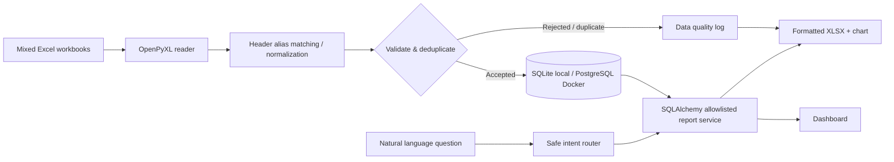

# LedgerLens — Enterprise Excel AI Copilot

**Portfolio MVP for AI Application Engineer / Enterprise AI Automation** · Python + FastAPI + SQLAlchemy + PostgreSQL-ready + Pandas + OpenPyXL + XlsxWriter + constrained NL intent planner.

LedgerLens turns heterogeneous, error-prone Excel reports into a canonical transaction dataset, flags bad/duplicate rows, shows a dashboard and exports query-driven Excel workbooks. It emphasizes **data quality, trustworthy numbers and constrained AI**, rather than generating unsupported financial claims.

> **Scope and honesty:** This is an independently runnable **local portfolio MVP**, not a real deployed ERP/KYC/OCR/RPA solution. AI uses deterministic intent classification by default; an optional local Ollama planner classifies report intent only. Neither planner may run arbitrary SQL. Excel exports contain **pivot-style grouped summaries**, not native Excel PivotTable objects. No real enterprise data or credentials are included.

## Verified engineering status

Last locally audited: **2026-10-24**. See the [final engineering audit](docs/FINAL_ENGINEERING_AUDIT.md) and [pre-fix baseline](docs/BASELINE_AUDIT.md) for reproduction evidence and prioritized findings.

### Validation results

| Check | Result | Notes |
|---|---|---|
| Automated tests | **32 passed** | Unit, ETL, API integration, security boundaries and XLSX export tests |
| Dependency consistency | **Passed** | `python -m pip check` |
| Python compilation | **Passed** | `python -m compileall -q app tests` |
| Package wheel build | **Passed** | Local wheel built without dependency resolution |
| HTTP smoke test | **Passed** | Health 200, missing API key 401, valid API key 200 |
| Docker Compose configuration | **Passed** | Configuration and environment interpolation only |
| PostgreSQL runtime | **Not verified** | Docker daemon/image unavailable during the audit; no Alembic migrations yet |
| Browser visual/E2E test | **Not verified** | No browser automation surface was available |
| Performance benchmark | **Not measured** | No throughput, latency, memory or time-saved claims are published |

One non-failing Starlette `TestClient` deprecation warning is currently emitted by the test dependency stack.

### Feature maturity

| Capability | Status | Verified scope |
|---|---|---|
| Multi-sheet XLSX ingestion | Implemented | Bilingual aliases, header offsets, malformed-row handling and bounded ZIP/XML traversal |
| Validation and deduplication | Implemented | Exact VND amounts, dates, versioned Unicode-safe identities and cross-import idempotency |
| Data lineage | Implemented | Batch, source file, sheet and original row exposed in API/export |
| Financial summaries | Implemented | Exact-Decimal totals grouped by department, month, type or status |
| Natural-language reporting | Implemented, constrained | Deterministic provider-off mode; optional loopback Ollama intent classification; no raw SQL or mutations |
| Excel reporting | Implemented, partial scope | Four formatted sheets, filters, chart, quality log and formula-injection defense; no native PivotTable |
| PostgreSQL | Configuration prototype | SQLAlchemy URL and Compose service exist; runtime and migration path are unverified |
| ERP synchronization | Not implemented | No simulator, adapter, retries, sync status or ERP reconciliation |
| Enterprise IAM/audit | Not implemented | Local shared key only; no RBAC, tenant scope or attributable audit trail |
| CI and browser E2E | Not implemented | Current verification is local and SQLite-centric |

## Architecture



## Features implemented

- **Multi-sheet Excel ingestion:** detects English/Vietnamese headers within the first 12 rows; supports heterogeneous column orders and common VND/date representations; skips metadata-only worksheets with an audit warning. **Max 8 MB / file, 5,000 data rows / import, 12 sheets.**
- **Normalization and anomaly log:** canonical invoice/date/department/counterparty/type/amount/status, rejects invalid data, fingerprints duplicates within and across batches, and persists import counts and up to 250 issue samples. Counterparty is part of the demo identity to avoid suppressing same-number transactions from different parties.
- **Persistent storage:** SQLAlchemy with SQLite as the verified local default and PostgreSQL configuration through Docker Compose; transactional import writes. Source file/sheet/row/batch retained for lineage. PostgreSQL runtime and migrations are not yet verified.
- **Controlled business intelligence:** exact Decimal revenue, expenses, receivables, payables and net balance; by department, month, type, or status; no LLM-created SQL. Monetary JSON fields are decimal strings so cents are not rounded by binary floating point.
- **Natural-language-to-report:** Vietnamese/English rule router and optional local Ollama **intent-only** planner with Pydantic allowlist. Source rows are never sent to the planner.
- **Excel export:** README metadata, pivot-style grouped summary, detailed normalized data, data-quality sheet, filter/freeze panes, cell formats, conditional formatting and column chart. Prevents Excel formula injection by disabling string-to-formula conversion.
- **Responsive UI** served by FastAPI, API key access control, Swagger/OpenAPI, repeatable integration tests and synthetic workbook fixtures.

## Quick start: macOS / Linux / Windows (PowerShell instructions below)

Requires Python 3.11+.

```bash
cd LedgerLens
python3 -m venv .venv
source .venv/bin/activate
pip install -e '.[test]'
./scripts/run_local.sh
```

Open <http://127.0.0.1:8000>. Open the protected local `.env` file in your editor and paste its `APP_API_KEY` value into the login dialog; the launcher does not print reusable secrets. Upload `examples/01_sales_standard.xlsx`, then `examples/02_messy_mixed_departments.xlsx`. Select a department/month breakdown, ask `Doanh thu theo phòng ban`, export an Excel report. For API documentation open <http://127.0.0.1:8000/docs>.

On Windows PowerShell: activate using `.venv\\Scripts\\Activate.ps1`, copy `.env.example` to `.env` and populate `APP_API_KEY`, then run `uvicorn app.main:app --env-file .env --host 127.0.0.1 --port 8000`. The bundled convenience shell script targets macOS/Linux.

### Docker Compose with PostgreSQL

```bash
export POSTGRES_PASSWORD="$(python -c 'import secrets; print(secrets.token_urlsafe(28))')"
export APP_API_KEY="$(python -c 'import secrets; print(secrets.token_urlsafe(32))')"
docker compose up --build
```

The API listens only on `127.0.0.1:8000` at the host. DB isn't exposed. The values above are ephemeral to the terminal session; use a secure secret manager in any real deployment. DO NOT publish it on a public server without authentication, migrations, TLS, audit logging, role controls, upload hardening, rate limiting and further security review.

## Verify

```bash
python -m pytest -q
```

Expected audited result: **32 passed**. The test suite configures its own temporary SQLite database and API key; PostgreSQL, Docker and a running application are not required. It verifies bilingual aliases, monetary/date normalization, malformed packages, request limits, Unicode/cross-batch deduplication, exact-cent totals, fail-closed natural-language routing, authenticated APIs, lineage, Excel output, quality logs and formula-injection defense.

Useful focused commands:

```bash
python -m pytest -q tests/test_etl.py
python -m pytest -q tests/test_api.py
python -m pytest -q tests/test_security.py
```

### Expected demo numbers

| Metric | Expected VND after importing both fixtures |
|---|---:|
| Accepted transactions | 12 |
| Rejected rows | 1 |
| Duplicate rows | 1 |
| Revenue | 40,800,000 |
| Expense | 9,640,000 |
| Receivable | 10,800,000 |
| Net revenue minus expense | 31,160,000 |

`02_messy_mixed_departments.xlsx` intentionally contains a repeated invoice, invalid numeric amount, a report-style title/header offset and a metadata-only sheet. A second import of the same file records new duplicates rather than duplicating ledger entries.

## API contract

| Method | Endpoint | Description |
|---|---|---|
| GET | `/healthz` | Local health check; public |
| GET | `/api/overview` | KPIs and quality counts |
| POST | `/api/imports` | XLSX multipart upload |
| GET | `/api/batches` | Recent imports and issue list |
| GET | `/api/records` | Recent normalized transactions |
| GET | `/api/reports/summary?group_by=month` | Allowed report breakdown |
| GET | `/api/reports/summary.xlsx?group_by=department` | Excel download |
| POST | `/api/ask` | Classify question to allowable report; return source-grounded totals |
| POST | `/api/ask/export` | Export report derived from question |

Authenticated endpoints require `X-API-Key`. All monetary metrics are based on accepted and normalized source records. Income minus expense is **not** a certified business profit or accounting balance.

## Why this aligns with an AI Application Engineer role

| Job requirement | This demo demonstrates | Gaps deliberately excluded |
|---|---|---|
| Data cleaning / dissimilar workbooks | Header/locale normalization, validation, QA log | Merged-cell recovery, exotic cross-workbook formulas |
| Python Excel & Data | OpenPyXL, Pandas, XlsxWriter | VBA, xlwings and Excel desktop automation |
| Centralized SQL storage | SQLAlchemy + local SQLite / Docker PostgreSQL | Enterprise ERP schema and live integrations |
| Text to Excel / AI Agent | NL intent -> safe report -> XLSX export | General reasoning model, native PivotTable |
| Dashboards | Responsive finance overview and grouped charts | Real-time streaming and advanced permissions |
| Security | API key, allowlisted intent, size limits, formula-escaping, no raw SQL | Enterprise IAM / OAuth, tenancy, comprehensive compliance |

## Roadmap (not yet implemented)

1. **V1:** Better Excel merged-cell normalization and multi-format data templates, explicit field mapping UI, reconciliation rules configurable by business domain.
2. **V2:** Read-only ERP connectors (Odoo/ERPNext mock first), signed webhooks, RBAC, audit trail, background jobs and PostgreSQL migrations.
3. **V3:** OCR receipt/document ingestion, async jobs, local Ollama evaluation benchmark, human-in-the-loop approvals and evaluation suite.
4. **V4:** Native Excel PivotTable generation where supported, time-window filters, production monitoring and performance profiling.

## Recruiter-facing summary

**LedgerLens — Enterprise Excel AI Copilot** | Python, FastAPI, Pandas, OpenPyXL, XlsxWriter, SQLAlchemy, PostgreSQL-ready, NLP routing

- Built a local FastAPI/SQLAlchemy pipeline that normalizes bilingual, multi-sheet XLSX transaction data, validates malformed rows, preserves file/sheet/row lineage and performs idempotent versioned deduplication.
- Implemented exact-Decimal financial summaries and safe multi-sheet Excel exports with grouped reporting, quality logs, filters, formatting, charts and spreadsheet-formula injection protection.
- Designed a Pydantic-constrained natural-language report planner with deterministic provider-off behavior and optional loopback Ollama classification, without arbitrary SQL or financial-data mutation capabilities.
- Hardened the local MVP with pre-parse API-key enforcement, request/XLSX traversal limits, ZIP protections and **32 passing local automated tests**.

**Do not claim:** production ERP integration, verified PostgreSQL migrations, OCR, VBA, native PivotTable, live RPA, multi-tenant security, production deployment, performance gains or user outcomes until implemented and measured.
